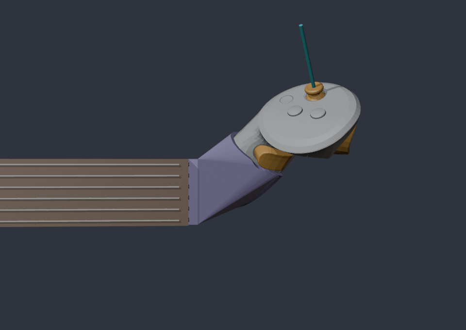
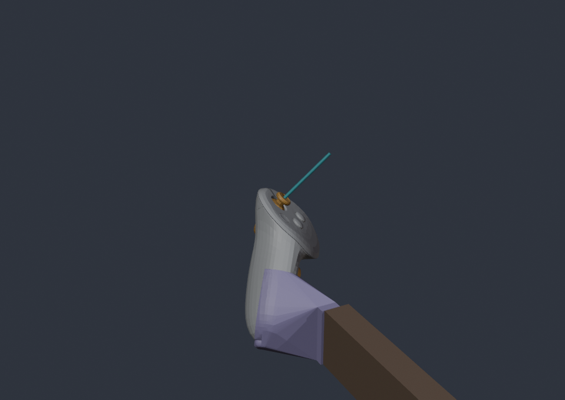
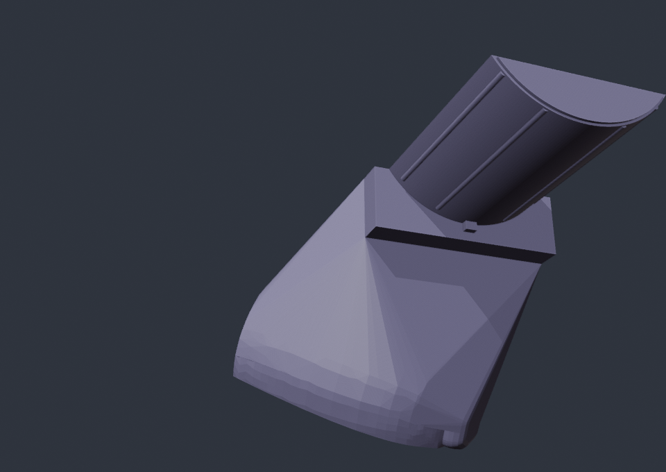

# Quest controller mount for a headless guitar

A 3D-printable mount that puts a **Meta Quest 3/3S Touch Plus** controller on
the head end of a headless guitar, so the headset always knows where the neck
is and the mixed-reality neck highway can sit on the real frets. The defaults
target a **Jamstik Studio** (headless, 24 frets, 25.5" scale, 40 mm at the nut).





The controller in these renders is Meta's own Touch Plus model, not a stand-in.

## The part

One printed piece, the `holder`, in the style of a clip-on weapon-light mount:

- **The plug** replaces the Jamstik's black D-shaped end cover, under the string holes. A copy of the cover's D, 45 mm long, with its locating tab, presses into the pocket, and crush ribs give it a tight fit.
- **The block** sits on the end face below the string holes, the head end's full width; the plug comes out of its back.
- **A solid** runs from the block's outside face to the back of the sleeve, with no thin arm.
- **The sleeve** follows the controller's real grip, a 2.5 mm wall 0.6 mm off it, and wraps past the grip's widest line so the controller clips in from the far side. No strap.

Nothing touches the strings, the top face, the nut screws or the finish.



## How the plug fits

The cover measured 37.00 mm across its flat edge and 12.38 mm to the end of its
tab; the tab stands about 1.9 mm out of the curve and is 2.9 mm wide. The curve
is an arc through the ends of the flat edge and its lowest point, about 21.6 mm
in radius, which is half the head end's width: the cover follows the round back
of the neck.

The plug's D is `d_fit` (0.15 mm) under that size all round, with a 0.5 mm step
at its tip to lead it in. Six crush ribs stand `d_rib` (0.2 mm) proud of the
measured D: four round the curve and two on the flat edge. They shave down as
the plug goes in, which gives a press fit without sanding the whole D. At 45 mm
long they run most of the plug's length, so expect a firm push. The tab is only
`d_cover_t` deep, as deep as the cover is thick, so it keys into the rim's
notch and the plug goes in only one way round.

With the guitar in playing position, the controller's weight presses the D
against the pocket's walls, so the shape holds it, not friction; 45 mm of plug
gives it a long lever against the pocket. Only a pull straight out of the
pocket (the guitar hung head-down, or a knock) relies on the ribs' grip. Until
that has been tried, tie a tether from the holder to the neck.

**Print `d_plug_fit_test.stl` first:** the first 10 mm of the plug on a 1.2 mm
plate. It takes minutes and shows whether `d_fit` and `d_rib` suit your printer
before you print the whole part.

## How the controller clips in

The build reads Meta's Touch Plus model and finds the controller's own frame
from it:

- **Grip axis:** a line through the centres of slices across the lower grip.
- **Top surface:** the face with the thumbstick and buttons. Its normal is
  50° off the grip axis, leaning toward the back of the grip, away from the
  trigger. It matches the model's thumbstick and button axes to about 1°.
- **Buttons, measured up the grip from its end:** the grip button runs 49–69 mm,
  the trigger 81–116 mm and the thumbstick 96–114 mm. The whole controller is
  122 mm along the grip axis.

The sleeve is built from the grip's own cross-sections: every 2 mm up the grip
(every 0.5 mm where its end rounds off), the outline of Meta's surface is
grown by the clearance for the pocket, and by the clearance plus the wall for
the outside, and the outlines are lofted together. So it follows the grip's
shape along its length, the way a printed mount hugs a controller. It covers
the grip's lowest 48 mm (`sleeve_len`), below the grip button, and closes in a
cup round the grip's end, which puts the controller in the same place every
time.

**The snap.** The sleeve's back faces the block and its opening faces away. The
build finds, height by height, how far past the grip's widest line the sleeve
can wrap before each rim has to flex more than `snap` (0.6 mm) to let the grip
through, and opens it there. At the defaults the opening starts about 5 mm past
the grip axis on a left controller and 6 mm on a right one.

**No button can be pressed.** The holder keeps at least `button_clear` (2.5 mm)
plus the clearance away from the trigger (and its travel), the grip button and
the thumbstick. Each build reports the real gaps. At the defaults, with a left
controller, the gaps are:

| Part | Gap to the holder |
|---|---|
| Grip button | 3.1 mm |
| Trigger | 36 mm |
| Thumbstick | 50 mm |

**Battery:** the model shows a separate panel on the palm side of the grip that
wraps round its end, which is likely the battery cover. The sleeve covers its
lower part, so unclip the controller to change the battery.

## 1. Measure first

Every guitar size is a parameter in `build_mount.py`, and **the guitar defaults
are guesses**. Measure with calipers, write your numbers into a copy of
`my_measurements.example.json`, and print a test fit before trusting them. The
controller is not measured: its shape comes from Meta's model.

**Guitar:**

| Parameter | What to measure |
|---|---|
| `nut_to_tip` | From the fretboard edge of the nut to the end face. |
| `d_top_z` | Height of the D pocket's flat top edge (just under the string holes), relative to the fretboard surface at the nut. Below is negative. The default, -6.6 mm, is read off a photo. It moves only the headset's first guess, not the fit. |
| `d_width` | The cover across its flat edge. Measured 37.00 mm. |
| `d_depth` | The cover from its flat edge to the bottom of its curve, without the tab. 10.4 mm: 12.38 mm measured with the tab, less the tab. |
| `d_tab_w`, `d_tab_len` | The cover's locating tab: its width (2.9 mm) and how far it stands out of the curve (1.9 mm). |
| `d_cover_t` | The cover's thickness, which sets how deep the plug's tab is. **Guessed at 1.5 mm.** |
| `d_plug_len` | How far into the pocket the plug reaches along the neck. 45 mm. |
| `head_width` | The head end's width at the end face. Measured 43.16 mm; the block is this wide. |
| `head_thickness`, `head_top_z` | The rest of the head end's size. Used for the stand-in and for the check that keeps the controller out of the guitar. |
| `string_spread` | Outer edge of low-E to outer edge of high-e. Used for the stand-in. |

**Fit (print choices):**

| Parameter | Default | What it does |
|---|---|---|
| `d_fit` | 0.15 mm | How far under the measured D the plug is, all round. |
| `d_rib` | 0.2 mm | How far the crush ribs stand proud of the measured D. Raise it if the fit test is loose. |
| `block_height` | 14 mm | Height of the block on the end face, from the D's flat edge down. |
| `end_wall` | 6 mm | Thickness of the block, out from the end face. |

**Controller:**

| Parameter | What it is |
|---|---|
| `controller_mesh` | Path to Meta's `MetaQuestTouchPlus_Left.fbx` / `_Right.fbx`; `{Hand}` becomes `Left` or `Right`. The default points at the Meta XR SDK in this repo's Unity package cache (`com.meta.xr.sdk.core/Meshes/MetaQuestTouchPlus/`). If the file is missing, the build stops and names this parameter. |
| `controller_hand` | `left` (default) or `right`. |

**Sleeve:**

| Parameter | Default | What it does |
|---|---|---|
| `sleeve_len` | 48 mm | How far up the grip, from its end, the sleeve reaches. Keep it below the grip button. |
| `sleeve_clear` | 0.6 mm | Room between the grip and the sleeve. |
| `sleeve_wall` | 2.5 mm | The sleeve's wall. |
| `snap` | 0.6 mm | How far each rim flexes as the controller clips in. Raise it for a tighter clip. |
| `button_clear` | 2.5 mm | Extra room kept round the trigger, grip button and thumbstick. |

## 2. Tape-test the angle

The controller sits past the head end with its grip toward the guitar, rising
from the line of the neck like a raised headstock.

| Parameter | Default | What it does |
|---|---|---|
| `grip_rise` | 40° | Lifts the controller from the neck line toward the low-E edge (up, when playing). |
| `grip_tilt` | 45° | Tips the controller back toward the player. |
| `face_roll` | 60° | Turns the controller about its grip. At 0° the top surface leans toward the player; positive values turn it toward the low-E edge. |
| `mount_roll` | 90° | Then turns the controller about the neck's direction: clockwise seen from the body, looking down the neck toward the head end. At 90° it rises with its top surface toward the audience. |
| `arm_back` | 60° | Where the sleeve meets the solid: out from the block, angled from the neck line toward the back of the neck, so nothing passes in front of the string holes. |
| `arm_len` | 25 mm | ...and how far out from the block's face. |

Every build prints how far the controller's top surface (its real normal, from
Meta's model) points from the player's eyes, and warns past 70°. **The defaults
give 75°**, because `mount_roll` turns the top surface toward the audience;
without it, it's 45°. Tracking may drop at 75°. The eye position is set by
`eye_toward_body`, `eye_up` and `eye_back` (mm from the nut). `preview_eyes.png`
shows what the headset sees.

Before printing, tape the controller to the head end at that angle and play for
a minute with the headset on. Once tracking stays steady, set the angles to
match.

## 3. Build the STLs

Needs Blender 4.2 or newer (4.5+ uses the faster Manifold booleans), and Meta's
model where `controller_mesh` points:

```bash
blender --background --factory-startup --python build_mount.py -- --params my_measurements.json
```

This writes `out/`:

- `holder.stl`, already turned for printing, standing on the plug's tip;
- `d_plug_fit_test.stl`, the first 10 mm of the plug on a thin plate;
- `assembly.stl`, the holder in place in the guitar's frame;
- `mount.blend`, the same with the guitar and Meta's controller in place, in millimetres;
- seven preview renders;
- `mount_offset.json`.

`out/` is git-ignored. The build also checks:

- every part is watertight and in one piece;
- the plug is long enough for its crush ribs behind the tab;
- the top surface's angle to the eyes;
- the gaps to the grip and every button;
- how far each rim flexes as the controller clips in;
- nothing of the holder is within `string_clear` (100 mm) in front of the string holes;
- the controller stays out of the guitar.

## 4. Print

- **PETG.**
- 0.2 mm layers, 4 walls, 40% gyroid infill.
- Print the fit test first, on its plate with the D up (the STL is turned that way). Press it in; if it is loose, raise `d_rib`, and if it won't go, lower it.
- Print the holder standing on the plug's tip (the STL is turned that way), so the D's outline is drawn in single layers and fits like the fit test.
  - It stands 110 mm tall, on the D's 2 cm² tip, so use a brim.
  - About 18 cm² overhangs past 45°, under the block and the solid and along the sleeve. Use tree supports.

## 5. Assemble

1. Take the black D cover off the guitar's head end and keep it. Press the plug into the pocket in its place, tab down into the rim's notch, pushing on the block.
2. Clip the controller into the sleeve from its open side, the grip's end down in the cup and its head up and away from the guitar. It goes in only one way round.
3. In the headset, run the guitar setup's alignment check once. Remount the same way every time (grip's end in the cup) and the saved alignment stays valid.

## `mount_offset.json`

Where the neck sits relative to the controller **model's origin**: the origin and
axes of Meta's `MetaQuestTouchPlus_<Hand>` model as Unity draws it, which is
where the Meta SDK's `OVRControllerPrefab` places it. Axes are the headset's
(Unity), in metres plus a quaternion. `reference_pose` names that pose. The key
names still say `grip` so that the Unity reader (`MountOffset.TryParse`) keeps
working.

The MR client uses the file as its first guess, before the alignment check.
It is exact for the CAD; it is out by as much as the guitar measurements are.
The check replaces it with the real numbers. The mount's job is to land in the
same place every time, which the cup at the grip's end makes possible.

## Meta's controller model: licence

The Touch Plus model is Meta SDK content (Meta XR SDK, `com.meta.xr.sdk.core`).
The build reads it in place, from wherever `controller_mesh` points, every time
it runs. Never commit the FBX, a converted mesh, or any file holding its
geometry. That includes `out/mount.blend`, which contains the controller. The
committed previews show the model only as renders.

## Not yet verified

- **Fit:** nothing has been printed yet.
  - The guitar numbers are guesses, apart from the D cover's size, the plug's length and the head end's width. The cover's thickness (`d_cover_t`) matters most for the plug.
  - The sleeve's fit and its snap depend on Meta's model matching a real Touch Plus to within the 0.6 mm clearance.
- **Battery cover:** which panel it is, and which way it slides, is read from the model's shape, not checked on a controller.
- **The plug's grip:** how the original cover stays in (a snap lip behind the rim, or friction) is unknown, so the plug relies on crush ribs. A lip would allow a snap-in plug. Until a pull straight out has been tried, keep a tether on.
- **Tracking:** at the default 90° `mount_roll` the top surface points 75° from the eyes. A controller that isn't held may lose tracking when its face turns away. Horizon OS may also switch to hand tracking when it sees the controller as set down.
- **Reference pose:** the client applies the offset to the controller's tracked pose. Whether that pose is exactly where the Meta SDK draws its model has not been checked on a headset. The alignment check absorbs any difference.

The MR client's guitar setup is where both tracking questions get handled. See
the guitar section of `docs/unity-mr-client-plan-2026-08-18.md`.
